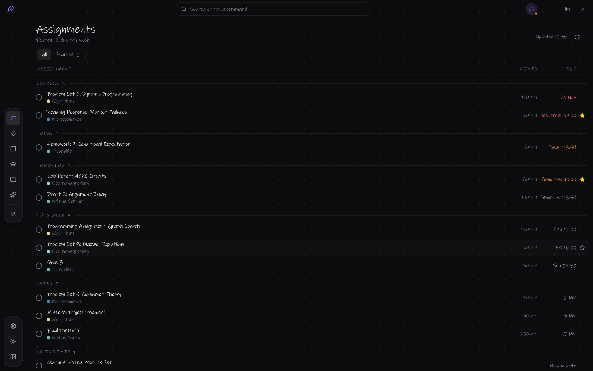
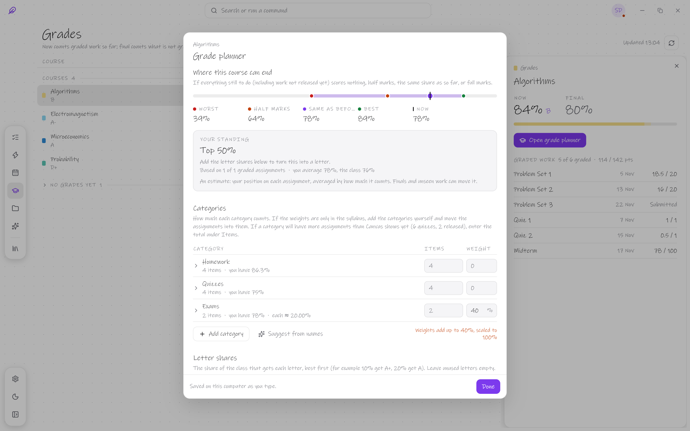
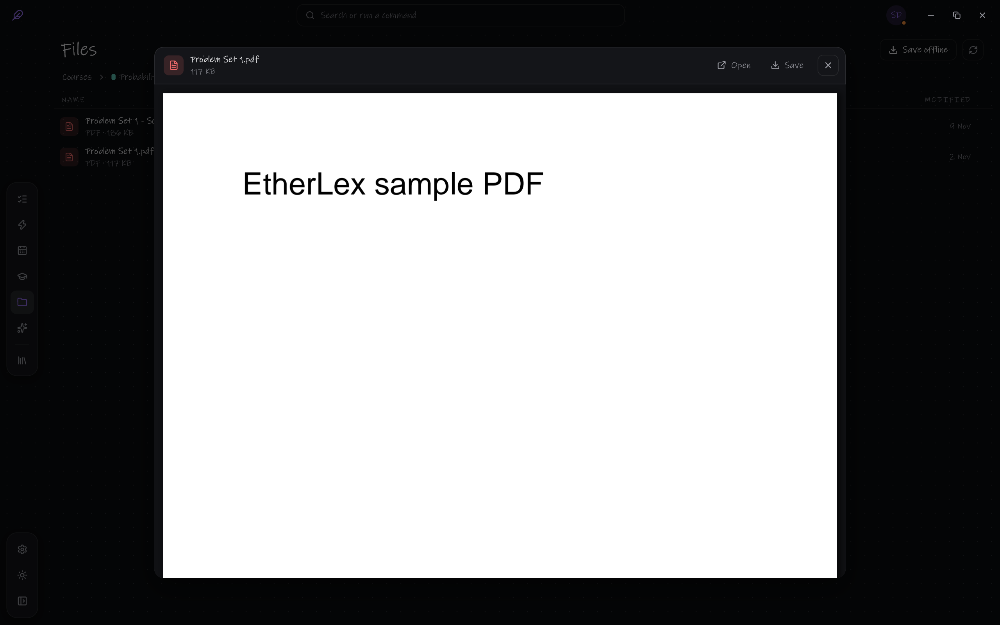
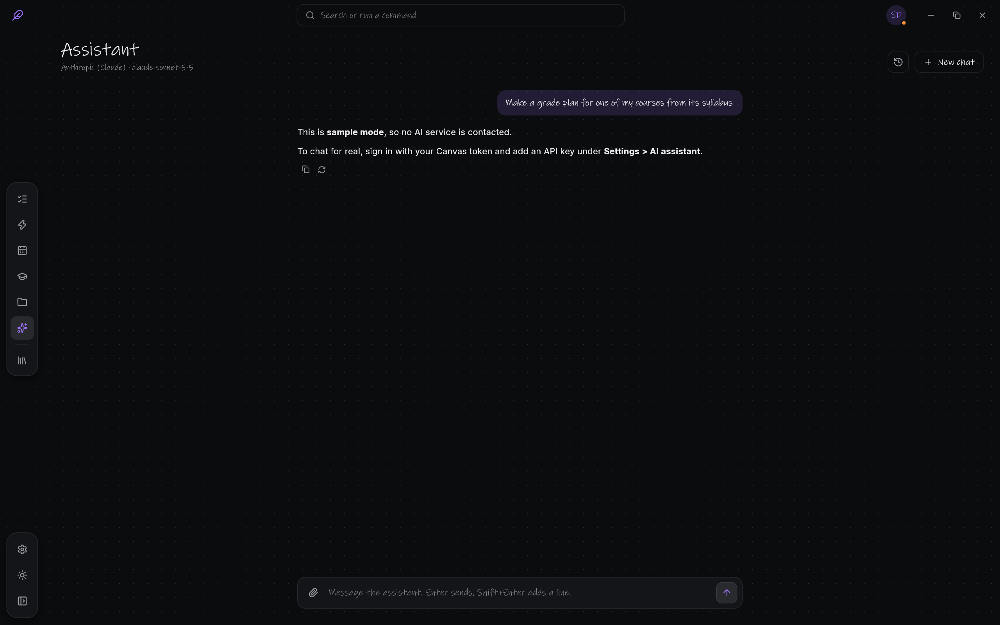
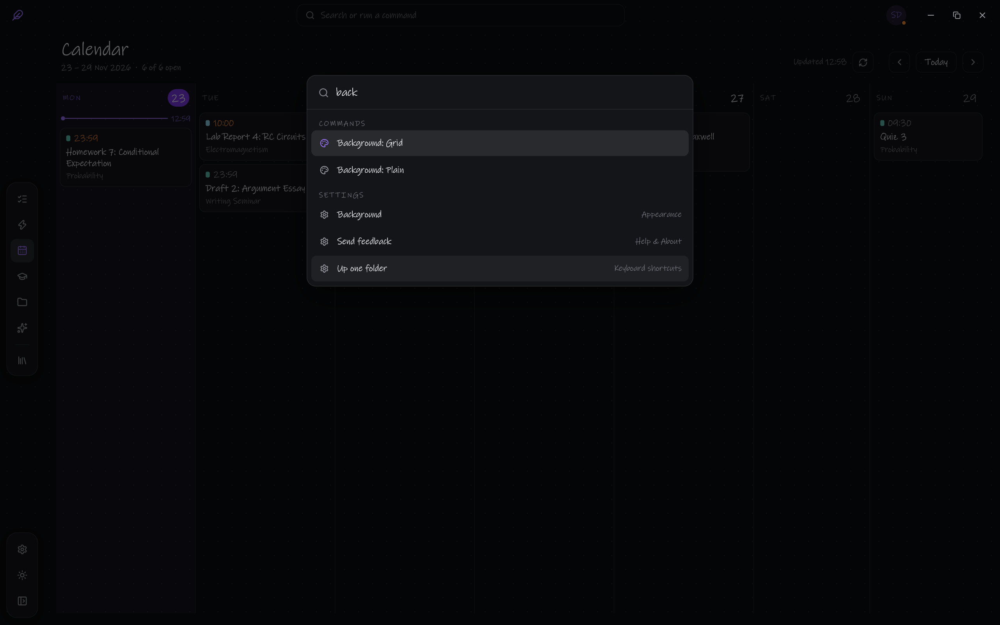

# EtherLex

A calm, fast, keyboard-first desktop companion for Canvas LMS. Everything due, every grade, every course file and an AI that knows your courses, in one window.

**Windows 10 and 11 only** (for now). Free and open source.



## Download
1. Get `EtherLex-Setup-<version>.exe` from the **[latest release](../../releases/latest)** and run it. No admin rights needed.
2. Sign in with your Canvas address and a personal access token, or click **Explore with sample data** to look around first.

**Getting a token:** in Canvas go to **Account > Settings > Approved integrations > New access token**, give it a name, generate it and paste it into EtherLex. Canvas shows it only once.

**"Windows protected your PC".** The installer is not code-signed yet, so SmartScreen warns about it. Click **More info**, then **Run anyway**. You only need this once: later updates are downloaded and checked by EtherLex itself.

To check that the file is the one we built, compare its SHA-256 with the `.sha256` file next to it on the release page:
```powershell
Get-FileHash .\EtherLex-Setup-<version>.exe -Algorithm SHA256
```

## What it does
- **Assignments**: one list from every course, grouped by when it is due, with a details pane (description, attachments, your grade, teacher feedback) and drag-and-drop submitting. Star what matters; finished work folds away.
- **Activity**: announcements, grades, discussions and messages in one feed, with pictures and links that open the exact file.
- **Calendar**: the week at a glance with a "now" line.
- **Grades**: every course with current and final grades, and a planner: your own category weights, where the course can still end, and your likely letter from class statistics.
- **Files**: course files with a built-in viewer (PDF, images, text, Markdown, Word and PowerPoint text), offline copies with a size limit, and downloads where you want them.
- **Assistant** (bring your own key: Anthropic, DeepSeek or any OpenAI-compatible service, also a model on your own computer): ask about your courses, attach assignments, grades and files, and let it propose a grade plan, stars or offline files. Nothing changes until you press Apply, and every change can be undone.
- **Ctrl+K** finds anything (assignments, announcements, files, chats, settings) and runs any action. **Ctrl+/** lists every shortcut.
- Light and dark, five accent colours, a handwritten or clean font, dotted or plain background, deadline and grade notifications, separate settings for each Canvas account.

| | |
| --- | --- |
|  |  |
|  |  |

## Privacy
- Your Canvas token is kept in the Windows credential store and only ever sent to your own Canvas, over https.
- Settings, the offline cache, grade plans and chats stay on your computer in `%APPDATA%\EtherLex`.
- The assistant is optional and uses your own API key (also in the credential store). Your messages go to the AI service you choose. Canvas data goes there only when you attach it or allow a lookup, after you agree once for that service, and you can take that back in Settings. You choose how long chats are kept.
- The update check asks GitHub for the latest release of this repository and sends nothing about you. It can be switched off in Settings.

## Develop
- Flutter 3.47.8 (pinned, see [CLAUDE.md](CLAUDE.md))
- Run: `flutter run -d windows --profile` (F9 shows frame times)
- Check: `flutter analyze` and `flutter test`
- Installer: `powershell -ExecutionPolicy Bypass -File installer\build.ps1` builds the release app and the installer in one go (needs Inno Setup 7). Don't run ISCC alone: it packs whatever release build is lying around, however old. Pushing a `v*` tag builds it and attaches it to a GitHub release.
- Manual test plan: [docs/TESTING.md](docs/TESTING.md) · What changed: [CHANGELOG.md](CHANGELOG.md) · Developer notes: [CLAUDE.md](CLAUDE.md)

Found a bug or have an idea? Use **Settings > Help & About > Send feedback**: it opens a prefilled GitHub issue (with no token, name or course in it) that you read before sending.

## License
MIT, see [LICENSE](LICENSE). Inter font: SIL Open Font License (`assets/fonts/Inter-LICENSE.txt`).
